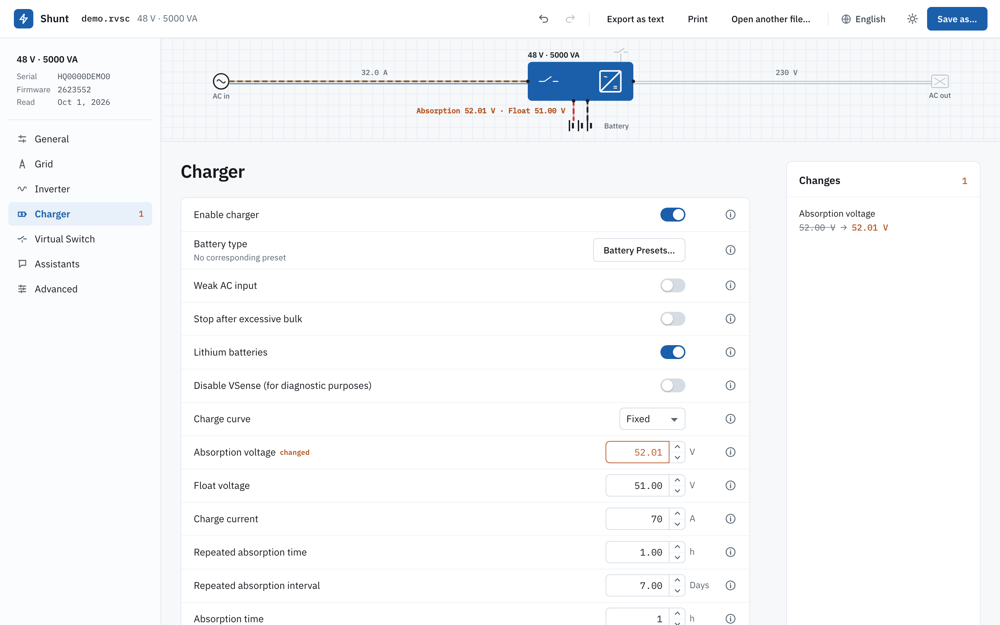
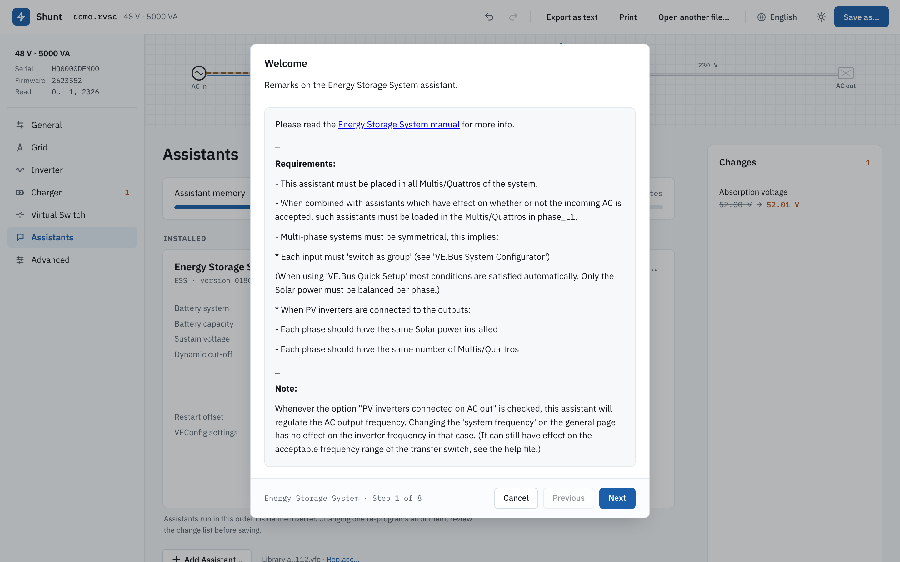
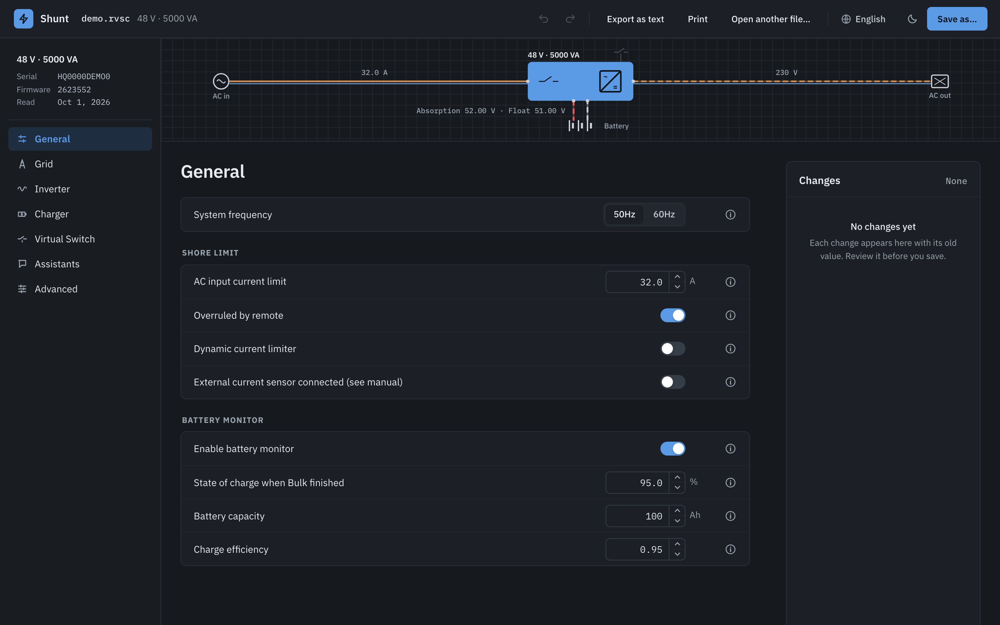
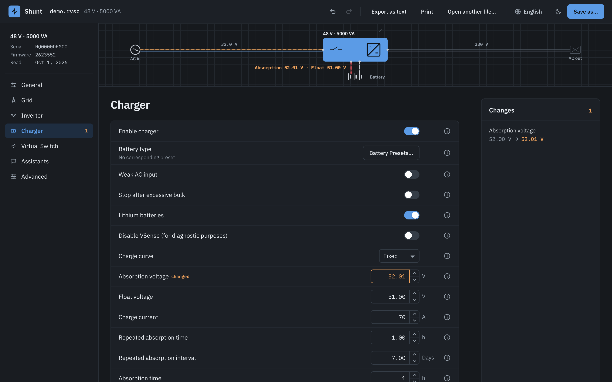
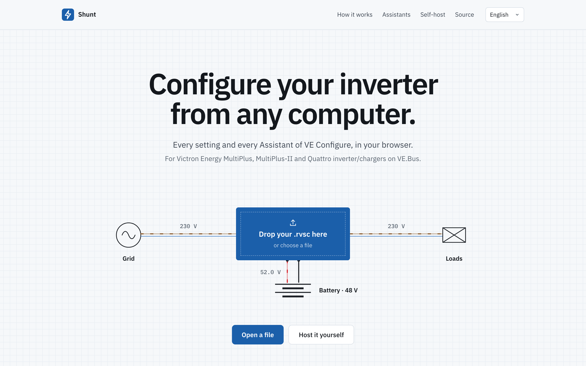
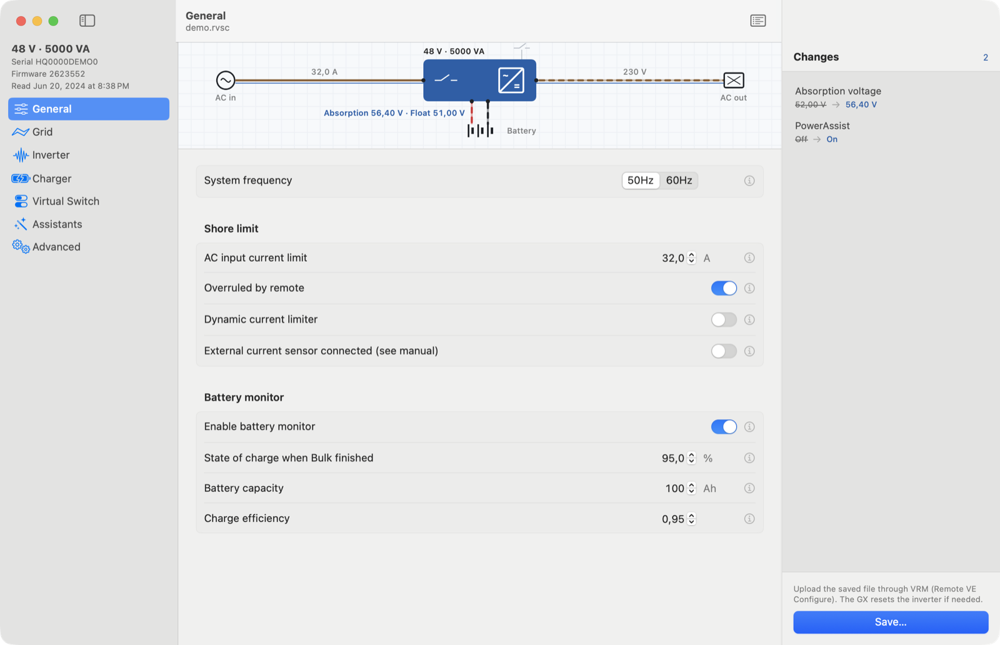
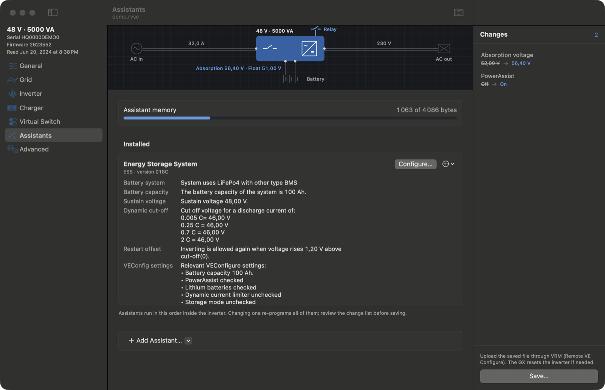

<p align="center">
  <a href="README.md">English</a> · <a href="README.fr.md">Français</a> · <b>Deutsch</b> · <a href="README.es.md">Español</a>
</p>

<h1 align="center">Shunt</h1>

<p align="center">
  VE.Bus-Wechselrichter/Ladegeräte von Victron Energy von jedem Computer aus konfigurieren.<br>
  MultiPlus, MultiPlus-II und Quattro, im Browser oder als Mac-App.
</p>

<p align="center">
  <a href="https://samr037.github.io/ve-conf-online/"><b>Shunt öffnen</b></a>
</p>

<p align="center">
  
</p>

Shunt öffnet die Konfigurationsdatei, die du von VRM herunterlädst (Remote VE Configure, `.rvsc`). Du änderst die Einstellungen, die VE Configure anbietet, führst Assistenten aus, prüfst jede Änderung und speicherst eine neue Datei, die du über VRM hochlädst.

## Was es kann

- **Alle sieben Reiter:** Allgemein, Netz, Wechselrichter, Ladegerät, Virtueller Schalter, Assistenten, Erweitert, mit den Bereichen, Abhängigkeitsregeln, Batterie-Voreinstellungen und Bestätigungen von VE Configure.
- **Assistenten, Byte für Byte:** ESS, Generator Start/Stopp, programmierbares Relais und die anderen werden aus Victrons eigenen Quellen assembliert. Das Programm in deiner Datei ist identisch mit dem von VE Configure, Prüfsumme eingeschlossen. Assistenten, die schon in einer Datei sind, werden mit ihren Antworten zurückgelesen.
- **Netzcodes:** geschützte Einstellungen werden mit dem Netzcode-Passwort entsperrt. Bereichs- und Auslöseschwellen-Prüfungen gelten weiterhin.
- **Änderungsliste:** jede Abweichung von der geladenen Datei, alt → neu, mit Rückgängig, Wiederholen, einzelnes Element oder alles wiederherstellen.
- **Vier Sprachen:** Englisch, Französisch, Deutsch und Spanisch, mit Victrons Begriffen.
- **Hell und dunkel.**
- **Weitermachen, wo du warst:** die geöffnete Datei, ihre Änderungen und der Rückgängig-Verlauf sind nach dem Neuladen der Seite noch da.

<table>
  <tr>
    <td width="50%"><br><sub>Der ESS-Assistent mit Victrons Schritttexten.</sub></td>
    <td width="50%"><br><sub>Reiter Allgemein, dunkel.</sub></td>
  </tr>
  <tr>
    <td><br><sub>Reiter Ladegerät, dunkel.</sub></td>
    <td><br><sub>Datei auf den Wechselrichter ziehen, um sie zu öffnen.</sub></td>
  </tr>
</table>

## Ablauf mit VRM

1. Öffne in VRM die Anlage, dann **Geräteliste › Remote VE Configure**, und lade die `.rvsc` herunter.
2. Öffne sie in Shunt. Ändere Einstellungen oder führe Assistenten aus und prüfe dann die Änderungsliste.
3. Speichere unter einem neuen Namen und lade die Datei auf derselben VRM-Seite hoch. Das GX überträgt sie an den Wechselrichter und setzt ihn bei Bedarf zurück.

## Selbst hosten

Die Seite ist statisch. Ein Container liefert sie mit nginx aus, ohne root, auf Port 8080.

```sh
docker run -d -p 8080:8080 --read-only --tmpfs /tmp ghcr.io/samr037/ve-conf-online
```

Oder mit Compose, aus `web/`: `docker compose up -d`.

- `GET /healthz` antwortet `ok`; das Image deklariert darauf einen Docker-Healthcheck.
- Der Container läuft schreibgeschützt mit einem tmpfs auf `/tmp`.
- Images werden für amd64 und arm64 gebaut.
- Links sind relativ, die Seite funktioniert also auch unter einem Unterpfad hinter einem Reverse Proxy.

## Mac-App

Derselbe Editor existiert als native macOS-App (SwiftUI und AppKit, macOS 14 oder neuer). Nötig sind die Command Line Tools (Swift 6), nicht Xcode.

```sh
scripts/test.sh          # Unit- und End-to-End-Tests (VEKit)
scripts/build-app.sh     # baut und installiert ~/Applications/VE Configure.app
```

`vecfg` ist das zugehörige Kommandozeilenwerkzeug:

```sh
swift build --scratch-path /tmp/vec-build --product vecfg
vecfg show file.rvsc                       # Einstellungen, Flags, Assistenten-Speicher
vecfg diff a.rvsc b.rvsc                   # was sich geändert hat
vecfg set file.rvsc UBatAbsorption=56.4 AssistEnabled=on -o out.rvsc
vecfg reconstruct allNNN.vfp file.rvsc     # Assistenten und Antworten zurücklesen
vecfg wizard allNNN.vfp file.rvsc ESS      # einen Assistenten ohne Oberfläche durchlaufen
```

<p>
  
  
</p>

## Entwicklung

Web-App (`web/`, Vite, Svelte 5, TypeScript):

```sh
cd web
npm ci
npm run dev            # http://localhost:5173
npx vitest run         # Unit-Tests
npx playwright test    # Tests im Browser
npm run build          # statische Seite in dist/
```

Swift (`Sources/`, `Tests/`):

```sh
swift build
swift test
```

Die TypeScript-Engine ist eine Portierung des Swift-Codes und wird Byte für Byte gegen ihn geprüft. Die Referenzdaten erzeugt `swift run vegolden web/fixtures/golden` aus echten Gerätedateien, die nicht in diesem Repository liegen. Tests, die sie brauchen, werden ohne sie übersprungen.

## Projektaufbau

| Pfad | Inhalt |
|---|---|
| `web/src/lib/engine` | Dateiformate, VLL-Assembler, Assistenten-Composer und -Wizard (TypeScript) |
| `web/src/lib/rules` | Einstellungskatalog, Regel-Engine, Wertumrechnung, Dokumentmodell (TypeScript) |
| `web/src/app`, `web/src/landing` | Editor und Startseite (Svelte) |
| `web/src/lib/device` | Direktverbindung über eine MK3-USB-Schnittstelle, Entwurf nur zum Lesen |
| `Sources/VEKit` | Dateiformate, Assembler und Assistenten-Engine (Swift) |
| `Sources/VEConfigure` | Die Mac-App |
| `Sources/vecfg`, `Sources/vegolden` | Kommandozeilenwerkzeug, Referenzdaten-Generator |
| `docs/re` | Notizen zum Reverse Engineering |
| `docs/audit` | Auditbericht und Stand der Korrekturen |

## Direktverbindung (MK3-USB), in Arbeit

Das Auslesen eines Geräts über eine MK3-USB-Schnittstelle mit Web Serial (Chromium-Browser) wird untersucht. Notizen und Entwurf nur zum Lesen: [web/docs/mk3-webserial.md](web/docs/mk3-webserial.md).

## Lizenz

Lizenz: noch offen.

---

Shunt ist ein unabhängiges Projekt, weder von Victron Energy erstellt, unterstützt noch empfohlen, und hat nichts mit Victrons SmartShunt zu tun. Victron Energy, VE.Bus, VE Configure, VRM, MultiPlus, Quattro und SmartShunt sind Marken der Victron Energy B.V.
