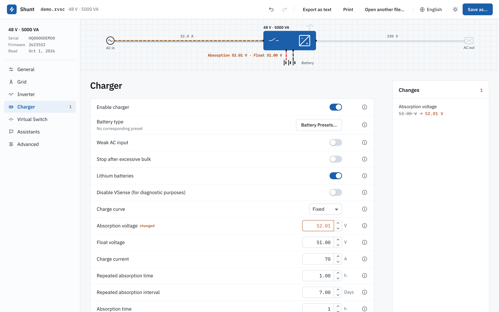
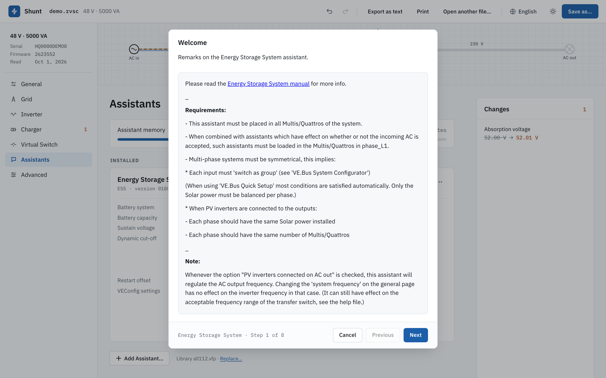
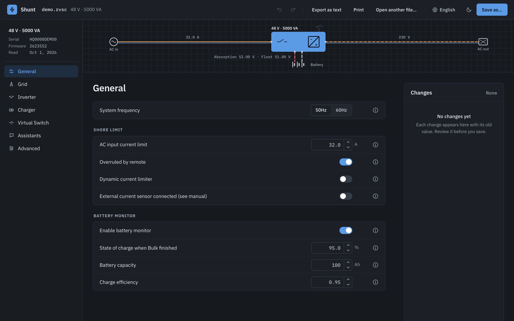
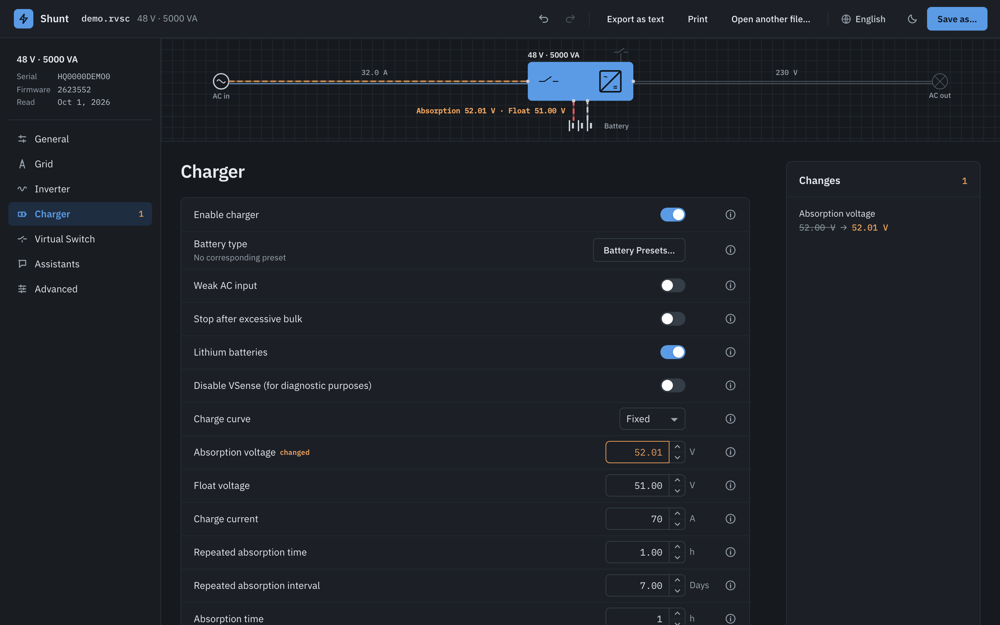
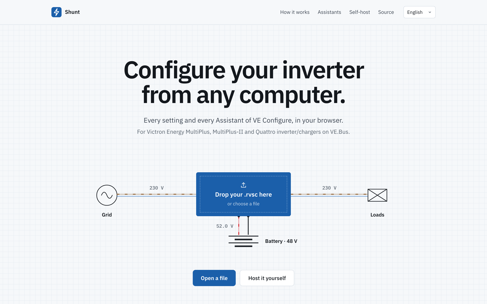
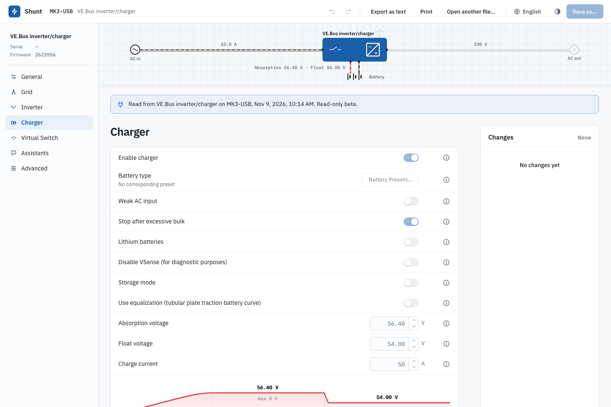

<p align="center">
  <a href="README.md">English</a> · <a href="README.fr.md">Français</a> · <a href="README.de.md">Deutsch</a> · <b>Español</b>
</p>

<h1 align="center">Shunt</h1>

<p align="center">
  Configura los inversores/cargadores VE.Bus de Victron Energy desde cualquier ordenador.<br>
  MultiPlus, MultiPlus-II y Quattro, en el navegador.
</p>

<p align="center">
  <a href="https://samr037.github.io/ve-conf-online/"></a>
  <a href="https://github.com/samr037/ve-conf-online/pkgs/container/ve-conf-online"></a>
  <a href="LICENSE"></a>
  <br>
  <a href="https://github.com/samr037/ve-conf-online/actions/workflows/pages.yml"></a>
  <a href="https://github.com/samr037/ve-conf-online/actions/workflows/swift.yml"></a>
  <a href="https://github.com/samr037/ve-conf-online/actions/workflows/codeql.yml"></a>
  <a href="https://scorecard.dev/viewer/?uri=github.com/samr037/ve-conf-online"></a>
  <a href="https://github.com/samr037/ve-conf-online/security"></a>
  <br>
  
  
</p>

<p align="center">
  <a href="https://samr037.github.io/ve-conf-online/"><b>Abrir Shunt</b></a>
</p>

<p align="center">
  
</p>

Shunt abre el archivo de configuración que descargas de VRM (Remote VE Configure, `.rvsc`). Cambias los ajustes que ofrece VE Configure, ejecutas los asistentes, revisas cada cambio y guardas un archivo nuevo que subes por VRM.

## Qué hace

- **Las siete pestañas:** General, Red, Inversor, Cargador, Interruptor virtual, Asistentes, Avanzado, con los rangos, las reglas de dependencia, los ajustes predefinidos de batería y las confirmaciones de VE Configure.
- **Asistentes, byte a byte:** ESS, arranque/parada del generador, relé programable y los demás se ensamblan a partir de las fuentes de Victron. El programa que se escribe en tu archivo es idéntico al de VE Configure, suma de comprobación incluida. Los asistentes que ya están en un archivo se leen con sus respuestas.
- **Códigos de red:** los ajustes protegidos se desbloquean con la contraseña del código de red. Las comprobaciones de rango y de orden de los umbrales de disparo se siguen aplicando.
- **Lista de cambios:** cada diferencia con el archivo cargado, antes → después, con deshacer, rehacer, restaurar un elemento o restaurarlo todo.
- **Cuatro idiomas:** inglés, francés, alemán y español, con el vocabulario de Victron.
- **Modo claro y oscuro.**
- **Sigue donde lo dejaste:** el archivo abierto, sus cambios y el historial de deshacer siguen ahí después de recargar la página.

<table>
  <tr>
    <td width="50%"><br><sub>El asistente ESS, con los textos de paso de Victron.</sub></td>
    <td width="50%"><br><sub>Pestaña General, modo oscuro.</sub></td>
  </tr>
  <tr>
    <td><br><sub>Pestaña Cargador, modo oscuro.</sub></td>
    <td><br><sub>Suelta un archivo sobre el inversor para abrirlo.</sub></td>
  </tr>
</table>

## Con VRM

1. En VRM, abre la instalación, luego **Lista de dispositivos › Remote VE Configure**, y descarga el `.rvsc`.
2. Ábrelo en Shunt. Cambia ajustes o ejecuta asistentes y revisa la lista de cambios.
3. Guarda con un nombre nuevo y súbelo en la misma página de VRM. El GX lo envía al inversor y lo reinicia si hace falta.

## Alojarlo tú mismo

El sitio es estático. Un solo contenedor lo sirve con nginx, sin root, en el puerto 8080.

```sh
docker run -d -p 8080:8080 --read-only --tmpfs /tmp ghcr.io/samr037/ve-conf-online
```

O con Compose, desde `web/`: `docker compose up -d`.

- `GET /healthz` responde `ok`; la imagen declara una comprobación de salud de Docker sobre él.
- El contenedor funciona en solo lectura con un tmpfs en `/tmp`.
- Las imágenes se construyen para amd64 y arm64.
- Los enlaces son relativos, así que el sitio también funciona en una subruta detrás de un proxy inverso.

## Desarrollo

App web (`web/`, Vite, Svelte 5, TypeScript):

```sh
cd web
npm ci
npm run dev            # http://localhost:5173
npx vitest run         # pruebas unitarias
npx playwright test    # pruebas en el navegador
npm run build          # sitio estático en dist/
```

Swift (`Sources/`, `Tests/`):

```sh
swift build
swift test
```

El motor TypeScript es un port del código Swift y se comprueba contra él byte a byte. Los datos de referencia salen de `swift run vegolden web/fixtures/golden`, que lee archivos reales de un dispositivo que no están en este repositorio. Las pruebas que los necesitan se omiten cuando faltan.

## Estructura del proyecto

| Ruta | Contenido |
|---|---|
| `web/src/lib/engine` | Formatos de archivo, ensamblador VLL, compositor y asistente (TypeScript) |
| `web/src/lib/rules` | Catálogo de ajustes, motor de reglas, conversión de valores, modelo de documento (TypeScript) |
| `web/src/app`, `web/src/landing` | El editor y la página de inicio (Svelte) |
| `web/src/lib/device` | Conexión directa mediante una interfaz MK3-USB o MK2, beta de solo lectura |
| `Sources/VEKit` | Formatos de archivo, ensamblador y motor de asistentes (Swift) |
| `Sources/vecfg`, `Sources/vegolden` | Herramienta de línea de comandos, generador de datos de referencia |

## Conexión directa (beta)

Conectar un equipo (beta, solo lectura): MK3-USB o MK2 en Chrome, Edge u otros navegadores Chromium en Windows, macOS, Linux y ChromeOS. Detalles y límites: [web/docs/mk3-webserial.md](web/docs/mk3-webserial.md).

<p align="center"><br><sub>Un equipo leído a través de una interfaz MK3-USB, solo lectura.</sub></p>

## Licencia

MIT, véase [LICENSE](LICENSE), [NOTICE](NOTICE). Los textos del catálogo y la biblioteca de Asistentes de Victron no están incluidos y siguen siendo propiedad de Victron.

---

Shunt es un proyecto independiente, no creado, respaldado ni apoyado por Victron Energy, y sin relación con el SmartShunt de Victron. Victron Energy, VE.Bus, VE Configure, VRM, MultiPlus, Quattro y SmartShunt son marcas de Victron Energy B.V.
