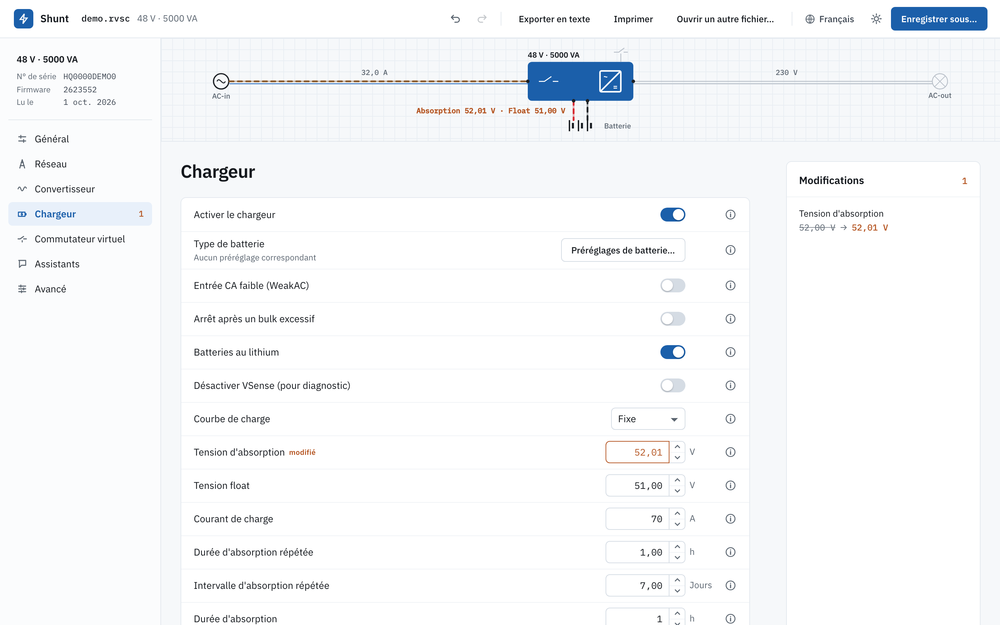
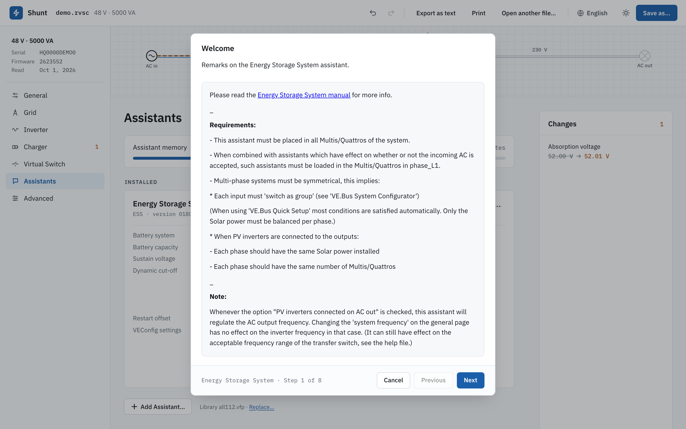
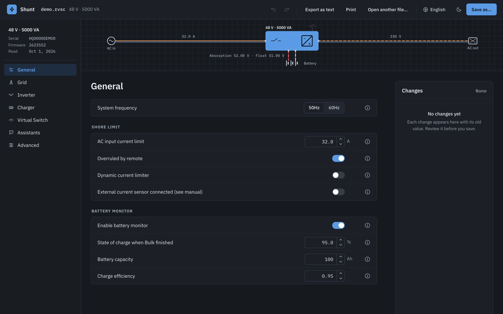
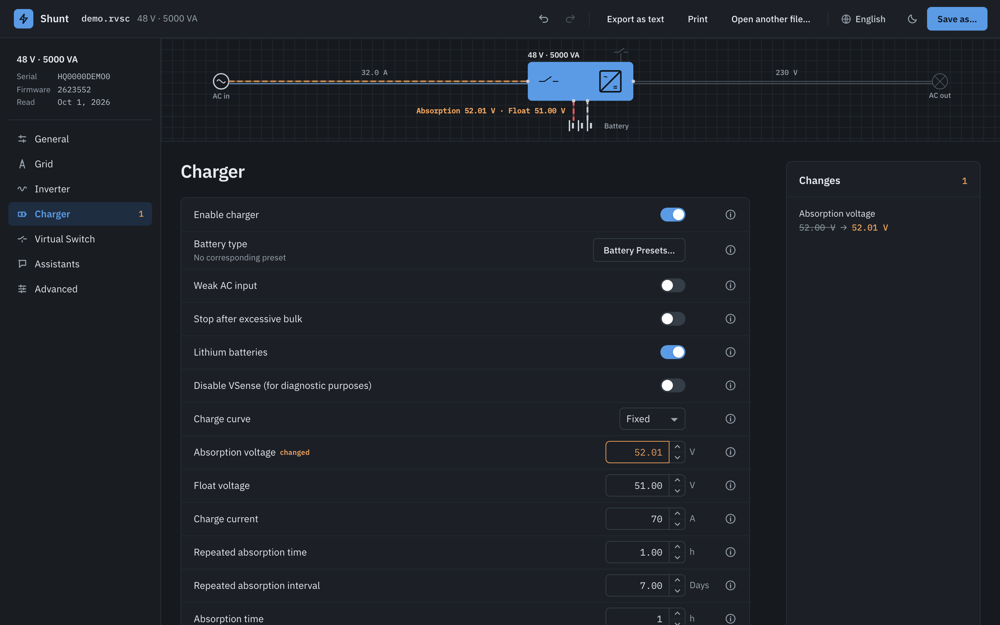
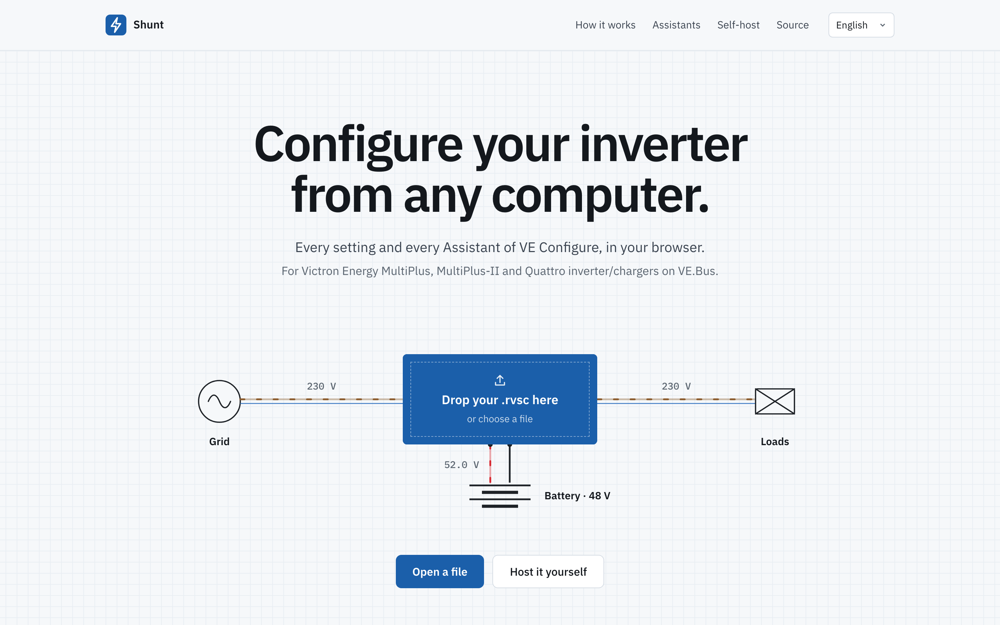
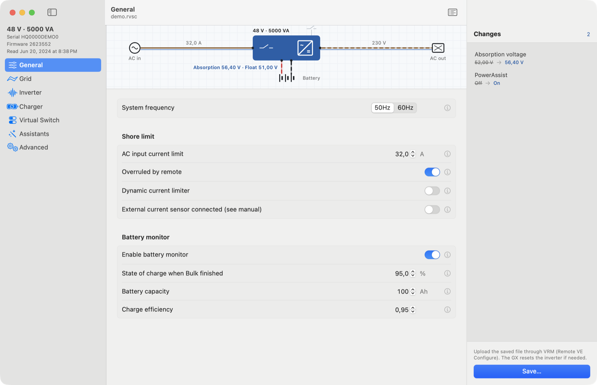
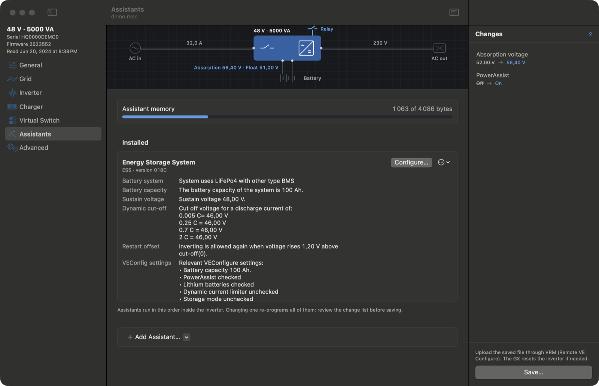

<p align="center">
  <a href="README.md">English</a> · <b>Français</b> · <a href="README.de.md">Deutsch</a> · <a href="README.es.md">Español</a>
</p>

<h1 align="center">Shunt</h1>

<p align="center">
  Configurer les convertisseurs/chargeurs VE.Bus de Victron Energy depuis n'importe quel ordinateur.<br>
  MultiPlus, MultiPlus-II et Quattro, dans le navigateur ou en app Mac.
</p>

<p align="center">
  <a href="https://samr037.github.io/ve-conf-online/"><b>Ouvrir Shunt</b></a>
</p>

<p align="center">
  
</p>

Shunt ouvre le fichier de configuration que tu télécharges depuis VRM (Remote VE Configure, `.rvsc`). Tu modifies les réglages que propose VE Configure, tu lances les assistants, tu relis chaque modification, puis tu enregistres un nouveau fichier que tu renvoies par VRM.

## Ce qu'il fait

- **Les sept onglets :** Général, Réseau, Convertisseur, Chargeur, Commutateur virtuel, Assistants, Avancé, avec les plages, les règles de dépendance, les préréglages de batterie et les confirmations de VE Configure.
- **Les assistants, à l'octet près :** ESS, démarrage/arrêt du générateur, relais programmable et les autres sont assemblés à partir des sources de Victron. Le programme écrit dans ton fichier est identique à celui de VE Configure, somme de contrôle comprise. Les assistants déjà présents dans un fichier sont relus avec leurs réponses.
- **Codes de réseau :** les réglages protégés se déverrouillent avec le mot de passe du code de réseau. Les contrôles de plage et d'ordre des seuils de déclenchement s'appliquent toujours.
- **Liste des modifications :** chaque écart avec le fichier chargé, ancienne → nouvelle valeur, avec annuler, rétablir, restaurer un élément ou tout restaurer.
- **Quatre langues :** anglais, français, allemand et espagnol, avec le vocabulaire de Victron.
- **Mode clair et mode sombre.**
- **Tu reprends là où tu en étais :** le fichier ouvert, ses modifications et l'historique d'annulation sont toujours là après un rechargement de la page.

<table>
  <tr>
    <td width="50%"><br><sub>L'assistant ESS, avec les textes d'étape de Victron.</sub></td>
    <td width="50%"><br><sub>Onglet Général, mode sombre.</sub></td>
  </tr>
  <tr>
    <td><br><sub>L'onglet Chargeur, mode sombre.</sub></td>
    <td><br><sub>Dépose un fichier sur le convertisseur pour l'ouvrir.</sub></td>
  </tr>
</table>

## Avec VRM

1. Sur VRM, ouvre l'installation, puis **Liste des appareils › Remote VE Configure**, et télécharge le `.rvsc`.
2. Ouvre-le dans Shunt. Modifie les réglages ou lance des assistants, puis relis la liste des modifications.
3. Enregistre sous un nouveau nom et envoie le fichier sur la même page VRM. Le GX le transmet au convertisseur et le redémarre si besoin.

## L'héberger soi-même

Le site est statique. Un seul conteneur le sert avec nginx, sans root, sur le port 8080.

```sh
docker run -d -p 8080:8080 --read-only --tmpfs /tmp ghcr.io/samr037/ve-conf-online
```

Ou avec Compose, depuis `web/` : `docker compose up -d`.

- `GET /healthz` répond `ok` ; l'image déclare un contrôle de santé Docker dessus.
- Le conteneur tourne en lecture seule avec un tmpfs sur `/tmp`.
- Les images sont construites pour amd64 et arm64.
- Les liens sont relatifs : le site fonctionne aussi sous un sous-chemin derrière un reverse proxy.

## App Mac

Le même éditeur existe en app macOS native (SwiftUI et AppKit, macOS 14 ou plus récent). Il faut les Command Line Tools (Swift 6), pas Xcode.

```sh
scripts/test.sh          # tests unitaires et de bout en bout (VEKit)
scripts/build-app.sh     # construit et installe ~/Applications/VE Configure.app
```

`vecfg` est l'outil en ligne de commande qui l'accompagne :

```sh
swift build --scratch-path /tmp/vec-build --product vecfg
vecfg show file.rvsc                       # réglages, flags, mémoire des assistants
vecfg diff a.rvsc b.rvsc                   # ce qui a changé
vecfg set file.rvsc UBatAbsorption=56.4 AssistEnabled=on -o out.rvsc
vecfg reconstruct allNNN.vfp file.rvsc     # relire les assistants et leurs réponses
vecfg wizard allNNN.vfp file.rvsc ESS      # dérouler un assistant sans interface
```

<p>
  
  
</p>

## Développement

App web (`web/`, Vite, Svelte 5, TypeScript) :

```sh
cd web
npm ci
npm run dev            # http://localhost:5173
npx vitest run         # tests unitaires
npx playwright test    # tests dans le navigateur
npm run build          # site statique dans dist/
```

Swift (`Sources/`, `Tests/`) :

```sh
swift build
swift test
```

Le moteur TypeScript est un portage du code Swift et il est vérifié contre lui à l'octet près. Les données de référence viennent de `swift run vegolden web/fixtures/golden`, qui lit de vrais fichiers d'appareil gardés hors de ce dépôt. Les tests qui en ont besoin sont ignorés quand ils sont absents.

## Organisation du projet

| Chemin | Contenu |
|---|---|
| `web/src/lib/engine` | Formats de fichier, assembleur VLL, compositeur et assistant (TypeScript) |
| `web/src/lib/rules` | Catalogue des réglages, moteur de règles, conversions de valeurs, modèle de document (TypeScript) |
| `web/src/app`, `web/src/landing` | L'éditeur et la page d'accueil (Svelte) |
| `web/src/lib/device` | Connexion directe par une interface MK3-USB, brouillon en lecture seule |
| `Sources/VEKit` | Formats de fichier, assembleur et moteur d'assistant (Swift) |
| `Sources/VEConfigure` | L'app Mac |
| `Sources/vecfg`, `Sources/vegolden` | Outil en ligne de commande, générateur de données de référence |
| `docs/audit` | Rapport d'audit et état des corrections |

## Connexion directe (MK3-USB), en cours

La lecture d'un appareil par une interface MK3-USB avec Web Serial (navigateurs Chromium) est à l'étude. Notes et brouillon en lecture seule : [web/docs/mk3-webserial.md](web/docs/mk3-webserial.md).

## Licence

MIT, voir [LICENSE](LICENSE). Les textes du catalogue et la bibliothèque d'Assistants de Victron n'en font pas partie et restent la propriété de Victron.

---

Shunt est un projet indépendant, ni réalisé, ni approuvé, ni soutenu par Victron Energy, et sans lien avec le SmartShunt de Victron. Victron Energy, VE.Bus, VE Configure, VRM, MultiPlus, Quattro et SmartShunt sont des marques de Victron Energy B.V.
