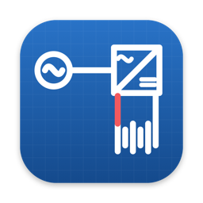
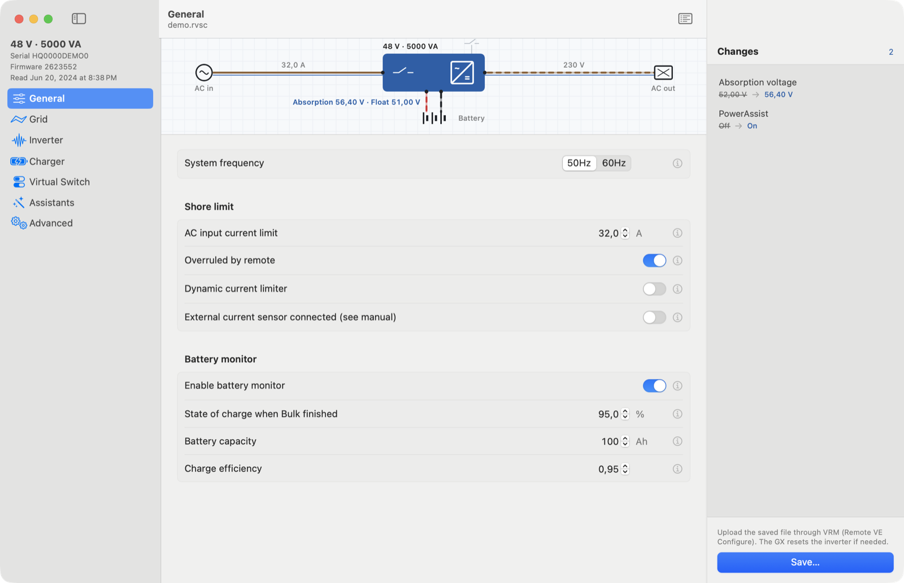
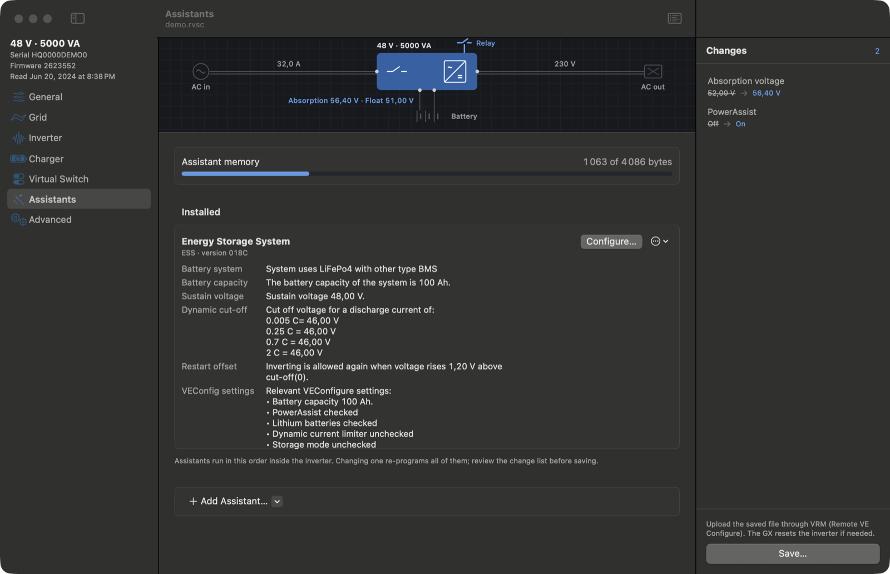
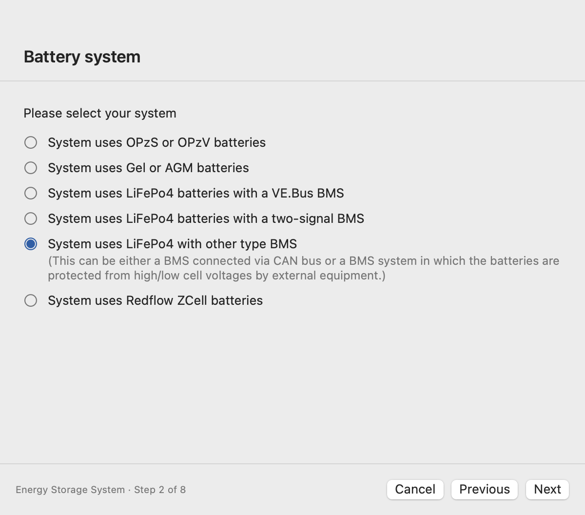
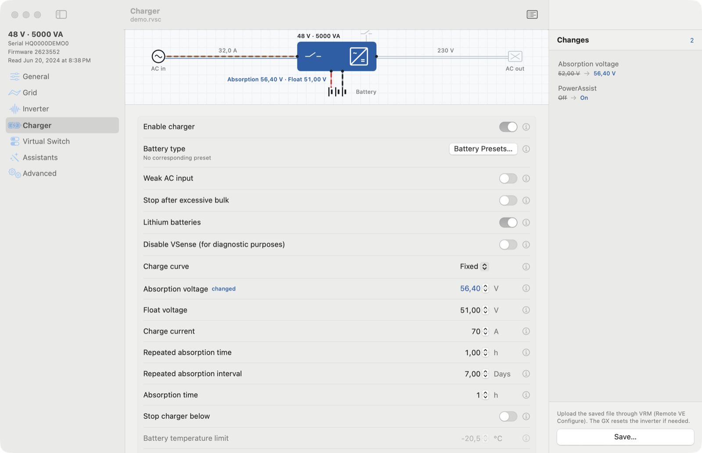
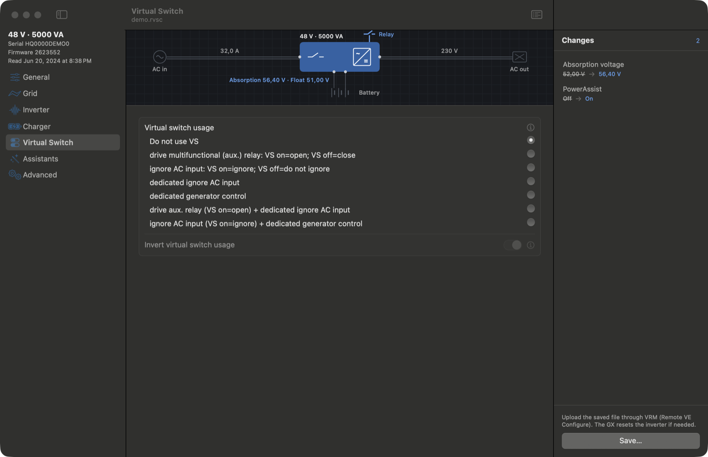
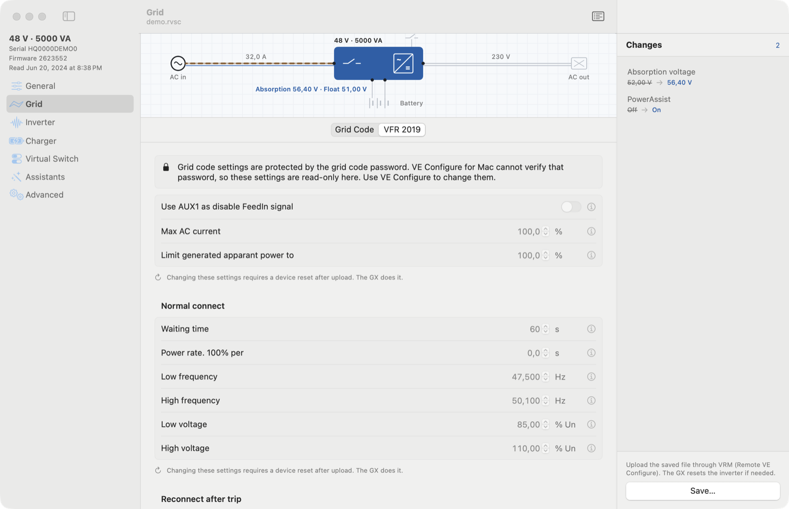

<p align="center">
  
</p>

<h1 align="center">VE Configure for Mac</h1>

<p align="center">
  A native macOS replacement for Victron Energy's Windows-only <b>VE Configure 3</b>,<br>
  for VE.Bus inverter/chargers: MultiPlus, MultiPlus-II, Quattro.
</p>

<p align="center">
  
  
  
  
  
  
</p>

<p align="center">
  
</p>

It opens the configuration file you download from VRM (**Remote VE Configure**, `.rvsc`). You change the settings VE Configure exposes and run the **Assistants** (ESS, generator start/stop, programmable relay…). It writes a **new** file for you to upload through VRM. The app never talks to a device.

> Independent project, not made or endorsed by Victron Energy. Victron Energy, VE.Bus, VE Configure and VRM are trademarks of Victron Energy B.V.

---

## Highlights

| | |
|---|---|
| **Assistants, byte for byte** | A port of VE Configure's VLL macro assembler re-assembles Victron's own Assistant sources. Programs are byte-identical to VE Configure's, checksum included: verified on a real ESS install and on every Assistant in the library. |
| **Read back what's in the inverter** | Assistants already in a file are reconstructed with their answers. Add, remove, reorder or re-run them step by step in Victron's original wizard texts. |
| **All seven tabs** | General, Grid, Inverter, Charger, Virtual switch, Assistants, Advanced. Pages are generated from VE Configure's own form layout, with its dependency rules, ranges, battery presets and safety confirmations. |
| **Review before you save** | A change list shows every difference from the loaded file (old → new), with undo and per-item restore. The original download is never overwritten silently. |
| **Single-line diagram** | AC in, inverter/charger, battery and AC out light up for the section you're on, with the key values on the wires. |
| **Native Mac** | Light and dark mode, sidebar navigation, ⌘Z, ⌘S, ⌘P, export to text, and an interface in English, French, German and Spanish using Victron's vocabulary. |

## Screenshots

<table>
  <tr>
    <td width="50%"><br><sub><b>Assistants</b>: the ESS program read back from the inverter, with its answers and memory use.</sub></td>
    <td width="50%"><br><sub><b>Wizard</b>: Victron's own step texts, re-assembled live on the Mac.</sub></td>
  </tr>
  <tr>
    <td><br><sub><b>Charger</b>: battery presets and the charge curve with dependency rules.</sub></td>
    <td><br><sub><b>Virtual switch</b>: every condition sheet of VE Configure.</sub></td>
  </tr>
  <tr>
    <td colspan="2"><br><sub><b>Grid code</b>: protected settings require the grid code password (see <a href="#safety">Safety</a>).</sub></td>
  </tr>
</table>

## Use

1. On VRM, open the installation, then **Device list › Remote VE Configure** and download the `.rvsc`.
2. Open it in VE Configure for Mac.
3. Change settings or run Assistants. Review the change list, then save under a **new** name.
4. Upload it on the same VRM page. The GX sends it to the inverter and resets it if needed.

**Assistant library.** The Assistants are Victron's programs and are not included. Import the library once from a VE Configure installation (`VE Configure tools/Assistants/allNNN.vfp`). The app keeps a copy in `~/Library/Application Support/VE Configure/`.

## Safety

This tool produces files that end up in a power device. It is built to refuse rather than guess:

- **Grid codes.** Enter the grid code password to unlock one document until it closes. Range, ordering and grid-parameter checks still apply. Saving records the verified authorization in the local file. GX acceptance has not been tested.
- **Ranges and order.** Values outside the device's range, and grid trip levels in the wrong order, are rejected with VE Configure's messages. Invalid grid parameters block saving.
- **Malformed files are refused**: duplicate sections, Assistant memory that isn't exactly 4096 bytes, firmware mismatch between sections, unknown format versions, compression bombs.
- **Assistant programs are checked to fit** in the inverter's memory before anything is written.
- **No device I/O.** Nothing is sent to an inverter, a GX or VRM.

An internal audit (5 parallel reviews, 81 findings, all fixed or documented) is in [`docs/audit/2026-10-16.md`](docs/audit/2026-10-16.md).

## Build

Command Line Tools (Swift 6) and macOS 14 or later. Xcode is not required.

```sh
scripts/test.sh          # unit + end-to-end tests (VEKit); add --skip LibraryWideTests for a fast run
scripts/build-app.sh     # builds and installs ~/Applications/VE Configure.app
```

Tests that need private fixtures or Victron’s library are skipped when `samples/` or `vendor/` is absent. CI reports these skips; it does not run the private-fixture tests.

### `vecfg`, the command-line companion

```sh
swift build --scratch-path /tmp/vec-build --product vecfg
vecfg show file.rvsc                       # settings, flags, assistant memory
vecfg diff a.rvsc b.rvsc                   # what changed
vecfg set file.rvsc UBatAbsorption=56.4 AssistEnabled=on -o out.rvsc
vecfg reconstruct allNNN.vfp file.rvsc     # read assistants and answers back, prove a byte-identical rebuild
vecfg wizard allNNN.vfp file.rvsc ESS      # walk an assistant headlessly
```

`vecfg` refuses to overwrite its input and re-reads what it wrote.

## How it works

```
 .rvsc ──► SettingFile ──► DeviceConfiguration ──► settings UI ──► change list ──► new .rvsc
 (VRM)     sections +       records, values,        (catalog +        (old → new)
           checksums        flags, RLE memory        rule engine)
                                   │
 allNNN.vfp ──► AssistantLibrary ──┴──► VLL assembler ──► 4096-byte program image
 (VE Configure)  .vap sources            (2 passes, macros,   (code · IDs · checksum)
                                          wizard steps)
```

| Path | What |
|---|---|
| `Sources/VEKit` | File formats (`.rvsc` sections and checksum, settings, RLE assistant memory), assistant library (`.vfp`/`.vap`), VLL macro assembler, assistant engine (`.AID/.AUE/.ALD`), META generator, wizard text rendering |
| `Sources/VEConfigure` | The SwiftUI/AppKit app |
| `Sources/vecfg` | CLI |
| `docs/re/` | Reverse-engineering notes: feature inventory, settings layout, assembler spec, UI rules, META environment |
| `docs/audit/` | Audit report and fix status |
| `tools/` | Python tools used during the reverse engineering |

`vendor/` holds Victron's installer and extracted files. It is git-ignored and never distributed.

## Status

Working: every tab, every applicable Assistant, the change list, export and print, four languages.

Not yet: the P(f)/Q(U) curve editors and the CEI/AS4777 derived tables (read-only), the ground-relay rule forced by some grid codes, and a direct MK3 connection (VRM + GX replaces it).

## Downloads and CI

Download a preview DMG from [GitHub Releases](https://github.com/samr037/ve-configure-mac/releases).
Choose **arm64** for Apple Silicon or **x86_64** for Intel. Open the DMG and drag the app to Applications.
These builds use an ad-hoc signature. They are not Apple Developer ID signed or notarized; Gatekeeper may block the first launch.

The [Test and package workflow](https://github.com/samr037/ve-configure-mac/actions/workflows/build.yml)
runs on each main push and pull request. It runs the available tests, builds both architectures,
then creates and mounts each DMG to verify its app signature and contents. Private samples and the
Victron library are absent from CI; tests that require them are reported as skipped.

A tag such as `v0.2.0` runs the same checks and publishes both DMGs and SHA-256 checksums as a private
preview release only after both jobs succeed. Developer ID signing and notarization are not configured.
